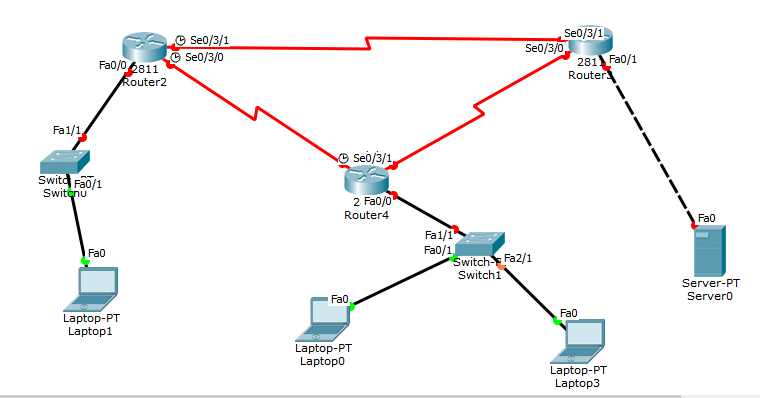

<h1 align="center">DHCP Using Cisco Packet Tracer</h1>

### Description
Implemented a demo topology to describe `Dynamic Host Configuration Protocol (DHCP)` using `Cisco Packet Tracer`.

### Topology

  

