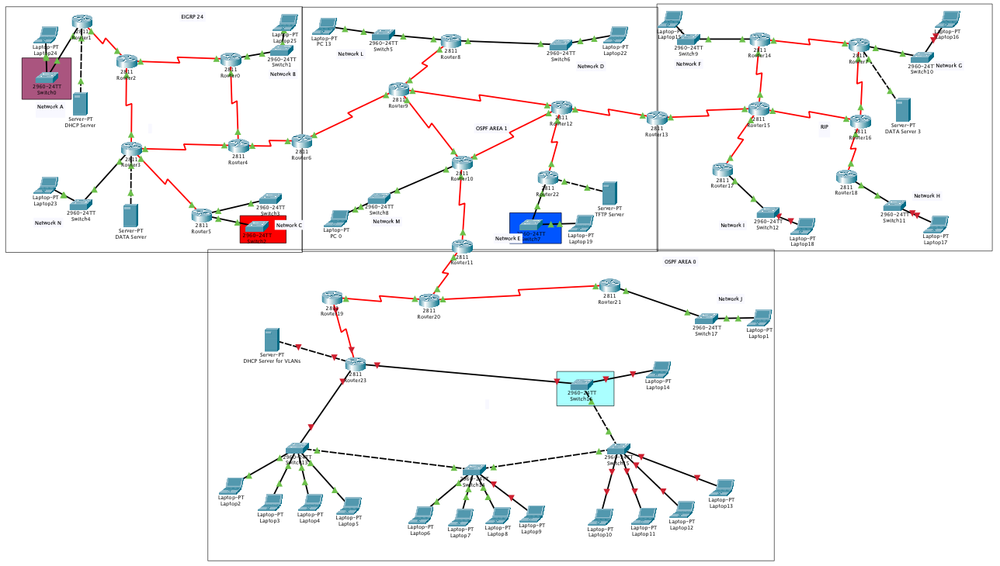

<h1 align="center">All Routing Protocols and Servers Using Cisco Packet Tracer</h1>

### Description
Implemented a complete network i.e, `Every Routing Protocol` (RIP, OSPF, EIGRP, DHCP, TFTP) and `Every Type of Server` (Web Server and Data Server) using `Cisco Packet Tracer`.

### Topology

  

### Subnetting

  

