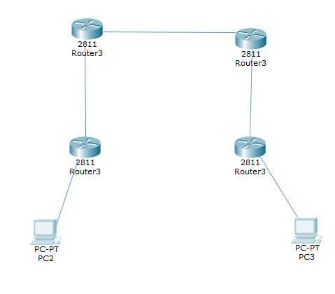
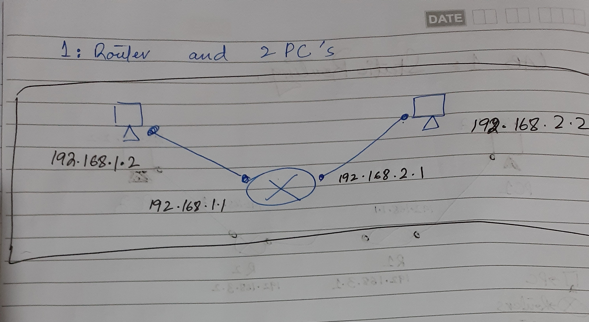

<h1 align="center">Static Routing Using Cisco Packet Tracer</h1>

### Description
Implemented two `Static Routing` topologies using `Cisco Packet Tracer`.

### Topology

  

### Configuration

  

