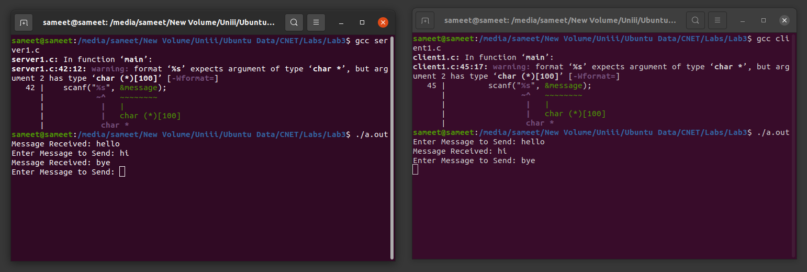

<h1 align="center">UDP Client Server Communication</h1>

### Description
A C socket implementation of connectionless client-server messaging over UDP.

### Manual
1) Use following commands to `Compile and Run Server Code`:
    ```
    gcc server.c
    ```
    ```
    ./a.out
    ```

2) Use following commands to `Compile and Run Client Code`:
    ```
    gcc client.c
    ```
    ```
    ./a.out
    ```
    
### Working Screenshot
<div align="center">
  
</div>
